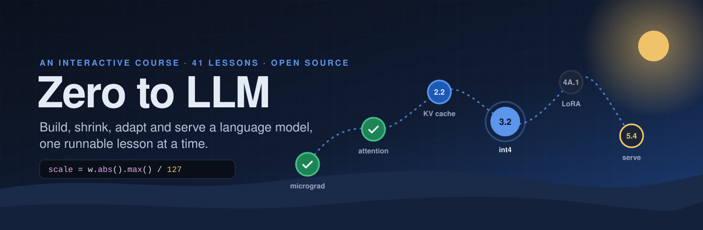

<p align="center"></p>

# Zero to LLM

**Build, shrink, adapt and serve a language model, one runnable lesson at a time.**

**▶ Take the course: [zero-to-llm.lum1neuz.workers.dev](https://zero-to-llm.lum1neuz.workers.dev)** · It runs in your browser and works offline after the first visit. No sign-up.

A free, hands-on course that takes you from autograd by hand to a quantized, fine-tuned, served LLM. It has 35 core lessons and 2 sidequests, about 197 hours over 20 weeks. You write every piece yourself, and tests check your code in the browser.

| Phase | What you build |
|---|---|
| 0 · Foundations | Python and tensor basics, micrograd, makemore, BatchNorm and manual backprop |
| 1 · Build a transformer | Self-attention, a full GPT block, training dynamics, a TinyStories 30M run, BPE, a tokenizer audit |
| 2 · Inference internals | Generation loops, the KV cache, sampling, batching, profiling and SDPA |
| 3 · Quantization | int8 absmax, group-wise int4, outliers, GPTQ, AWQ and NF4, llama.cpp k-quants |
| 4A · Adaptation | LoRA from scratch, QLoRA, corpus construction, a control run, instruction tuning and evals |
| 4B · Vocabulary research | Training a tokenizer for a new language, vocab extension, continued pretraining, a four-way comparison |
| 5 · Serving | vLLM vs llama.cpp, PagedAttention, speculative decoding, continuous batching and prefix caching |
| Sidequests | AlphaZero tic-tac-toe and Connect 4 |

The adaptation phases use **Mongolian** as the case study: a language that general-purpose tokenizers serve poorly. The same steps work for any language.

### How it teaches

- **Learn** (phone): 5–8 short cards per lesson, with sliders, fill-in-the-blank, predict-the-output, reorder, calculations and a quiz. Missed questions come back after 1, 3 and 7 days.
- **Build** (laptop): a short narrated setup types only the stub, then you write the code. **Run tests** runs real Python in your browser (Pyodide). When a test fails, it explains *your* mistake ("your scale comes from 1.0, not −3.0, which weight has the largest magnitude?"). Hints unlock one rung at a time, and the solution is never typed for you.
- **Read**: a plain-language **primer** to read before the cards, plus each lesson and its papers at four depths, from a one-line gist to full notes.
- Steps that need a GPU come with a recorded run to compare against. The recordings in this repo are **illustrative samples**, not real measurements. Run it yourself and record your own metrics.

Everything runs on your device: no account and no server. Progress moves between phone and laptop as a JSON file.

### Quick start

```bash
git clone https://github.com/lum1neuz/zero-to-llm.git
cd zero-to-llm
npm install
npm run dev
```

Then open the URL it prints. You need Node 22.18 or newer. Python is not needed: Pyodide runs it in the browser and in the test scripts.

---

## Working on the course

One content source (lesson Markdown) → a validator → `course.json` → this Astro + React PWA. A Flutter app can read the same `course.json` later.

## Commands

| | |
|---|---|
| `npm run dev` | Build content, copy Pyodide into `public/`, start the dev server |
| `npm run validate` | Check every lesson, print issues with file:line. `-- --only 1.2,1.3` reports only those lessons |
| `npm run content` | Validate and write `generated/course.json`, `generated/course.schema.json`, `public/course.json` |
| `npm run check:challenges` | (`-- --only <ids>` to limit) Run each challenge's solution, alternatives and known mistakes through the real harness in Pyodide (Node) |
| `npm test` | Validator and mini-torch tests (`node --test`) |
| `npm run typecheck` | TypeScript |
| `npm run build` | Production build into `dist/` with a precaching service worker |
| `npm run deploy` | Build and deploy to Cloudflare (static assets, `wrangler.jsonc`). Needs `npx wrangler login` once |

Requires Node ≥ 22.18 (TypeScript runs natively, no build step for scripts). No Python install is needed. Pyodide runs Python in both Node and the browser.

## Layout

```
content/                   the only content source
  course.yaml              phases, weeks, protected/optional flags
  lessons/<id>-<slug>.md   a stub: frontmatter only
  lessons/<id>-<slug>/     a full lesson: lesson.md + challenge files + replays
python/                    torch.py (mini-torch shim), harness.py (test runner), TORCH_SUBSET.md
pipeline/                  parse.ts, schema.ts (Zod), compile.ts (validate + emit), cli.ts, check-challenges.ts, test/
src/                       Astro pages + React islands
  components/home/         path, schedule, review, me, lesson sheet
  components/learn/        card player
  components/build/        workspace, challenge (editor, tests, hint ladder, console), replay, metrics
  lib/                     progress store, Pyodide client, metrics, text rendering
public/                    py-worker.js, sw.js, manifest, icons (pyodide/ and course.json are generated)
scripts/                   copy-pyodide.ts, sw-manifest.ts, make-icons.ts
```

## Writing a lesson

A lesson is Markdown with YAML frontmatter. Stubs have frontmatter only. A ready lesson (`status: ready`) adds the body. See `content/lessons/3.1-int8-absmax/lesson.md` for a complete example.

### Frontmatter

| Field | |
|---|---|
| `id`, `title`, `summary?` | `3.1`, `4A.2`, `S1`. The file or folder name starts with `<id>-` |
| `phase` | Must match the id prefix and exist in `course.yaml` |
| `hours` | Planned hours |
| `type` | `build` (browser challenges) · `run` (GPU-heavy, replays) · `research` (open-ended) · `sidequest` (optional phase only) |
| `status` | `stub` or `ready` |
| `protected` | Never cut. Required for every lesson in a protected phase |
| `cut` | Position in the behind-schedule cut order (1, 2, 3…) or `null` |
| `prerequisites` | Lesson ids |
| `fallbacks` | `{ "<prereq id>": "what to use instead" }`. Required when a never-cut lesson depends on a cuttable one |
| `papers` | `{ title, authors?, year?, url? }` |
| `quality_metric`, `systems_metric` | `{ id, label, unit, note?, inputs?, compute?, reference?, pass? }`. Ready lessons need `inputs`, `compute` (`value` · `pct_change` · `ratio`, baseline input first), `reference` and `pass: { max | min }` |
| `quiz` | 2–3 questions `{ id, q, answer, options: [{ text, why }] }`. Required when ready; every option explains itself |

### Body sections

`## Goal` · `## Learn` · `## Build steps` · `## Hints` (optional) · `## Done when`

**Learn** holds only ` ```card ` blocks of YAML, 5–8 cards including quiz cards. Every card has `id`, optional `eyebrow` and `title`. Exercises take one optional `hint`. With the hint used, a correct answer earns 3 XP instead of 5.

| `type` | Fields |
|---|---|
| `concept` | `body`, `visual?` (`kind: bars`, `max`, `bars[]`, `limit?`) |
| `slider_viz` | `viz: quant_grid`, `params { weights, min_bits, max_bits, start_bits, error_limit }`, `goal: fewest_bits_under_limit`, `answer` (recomputed by the validator) |
| `fill_blank` | `code` with `[[0]]`, `[[1]]` slots, `tokens`, `answer[]`, `tips { token: why }`, `why_ok`, `why_wrong` |
| `predict` | `code`, `options[] { text, correct?, why }` (exactly one correct) |
| `reorder` | `lines` (correct order), `shuffle` (display permutation), `why_ok`, `why_wrong` |
| `calc` | `given[] { label, value }`, `unit`, `answer { min, max }`, `why_ok`, `why_wrong` |
| `quiz` | `ref: <frontmatter quiz id>`. Quiz questions not placed go at the end of the deck |

**Build steps** are `### Title` headings, each with one block:

- ` ```challenge `: `id`, `file`, `start` (`{ code }` or `{ from: <earlier challenge> }`), `setup` (narrated segments `{ say, type | type_file, pause }`), `tests`, `solution`, `alternatives[]`, `hints { nudge, concept, skeleton, solution }`, `on_solve`, `mistakes[] { file, fails, says }`.
- ` ```replay `: `id`, `intro`, `log` (JSONL lines `{ t, c, layer?, label?, value?, delay? }`), `recorded { hardware, date?, illustrative, note? }`, `chart?`, `summary[]`, `run_yourself?`.
- ` ```metrics `: `id`, `intro?`. Uses the frontmatter metrics.

**Done when** has 2–4 checkboxes: `- [ ] Text {#id}` or `{#id auto=challenge:<id>}`, `auto=metrics` or `auto=learn`. Learn plus every box completes the lesson.

### Reading: primers, the fold reader and paper notes

- **Primers** are optional `primer.md` files in a lesson folder: a plain-language reading to do before the cards, for someone meeting the ideas for the first time. They need frontmatter with a one-sentence `gist` and optional `minutes`, then `## Section {#id}` sections, each with a `> key sentence` and the explanation. They open fully unfolded on the Read page, and the lesson sheet and the first Learn card link to them. Keep code lines under about 40 characters so they fit a phone. See `content/lessons/0.0-python-bridge-and-environment/primer.md`.

`/read/<id>/` shows a lesson's reading at four depths: **Gist** (one line) → **Map** (section titles) → **Keys** (one key sentence per section) → **Full**. Tapping a section or its key unfolds just that section, so every key leads back to the text it summarises.

- **The lesson fold** is generated by the pipeline from what a ready lesson already contains: Goal, concept cards, exercises, quiz, Build step narration, the lesson-level `## Hints` (general tips), Done when. Exercise and quiz explanations are `locked: learn` and show only after Learn is done. Challenge hint ladders (nudge to solution) and reference solutions never appear, and replays are labelled as illustrative recordings.
- **Paper notes** are optional files in a lesson folder, `papers/<kebab-name>.md`, one per paper. Write them in your own words. Don't paste paper text: most papers don't license redistribution.

```md
---
paper: LLM.int8()        # must equal the title of one of the lesson's frontmatter papers
gist: One sentence on what the paper shows.
---

## Emergent outlier features {#outliers ref="§3"}
> One key sentence for this section.

Notes in Markdown, as long as they need to be.
```

Every section needs an `{#id}`, a `> ` key sentence and notes. `ref` (optional) points readers at the paper's own section. See `content/lessons/3.1-int8-absmax/papers/llm-int8.md`.

### Challenge tests

`tests.py` uses `python/harness.py`:

```python
from harness import test, fail, warn, learner_fn, arr, as_float

@test("largest_is_127", "The largest |w| lands on ±127")
def _(L):
    quantize = learner_fn(L, "quantize_absmax")   # explains missing names and learner exceptions
    q, scale = quantize(torch.tensor([-3.0, 1.0, 0.5, -0.2]))
    if ...:
        fail("Your scale comes from 1.0, not −3.0. Which weight has the largest *magnitude*?")
```

Diagnose from behaviour (values your tests compute), not from regexes over source. Every mistake you list in `mistakes` is run by `npm run check:challenges`, and it must fail first on the named test with a diagnostic containing `says`.

### What the validator enforces

Ids match file names; phases exist; prerequisites exist with no cycles; cut numbers are unique, run 1..n, and never sit on protected or optional lessons; never-cut lessons need fallbacks for cuttable prerequisites; quiz answers are in range with an explanation per option; block schemas are strict (unknown keys fail); fill-blank answers are tokens; predict has one correct option; the slider answer is recomputed; the reorder shuffle is a real permutation; decks have 5–8 cards; **the narrated setup never types a line of the solution** and ends on `...` placeholders; skeletons have `____` blanks; the hint solution matches the reference file; referenced files exist; mistakes name real tests; Done-when has 2–4 items with valid `auto` targets; ready lessons have complete metrics.

## course.json

`generated/course.json` is client-agnostic: camelCase keys, Markdown kept as strings, challenge Python inlined, `runtime` carries the mini-torch and harness sources plus the Pyodide version. `generated/course.schema.json` is the JSON Schema for it, generated from the same Zod schema (`pipeline/schema.ts`). Use it for Flutter.

## Progress and sync

Everything lives on the device (`localStorage`, key `z2l.progress.v1`). XP and the streak are derived from records, never stored as counters. **Me › Download progress** writes a JSON file, and **Import** merges record by record: a solved challenge beats an unsolved one, and other records keep the newer side. Phone Learn work and laptop Build work combine. Missed quiz questions come back after 1, 3 and 7 days. A miss resets to 1 day; a right answer at 7 days retires the question.

## Notes

- The replay in 3.1 is **illustrative** sample data from the prototype, labelled as such in the UI. Replace `replays/quantize-30m.jsonl` with a log of a real run and set `illustrative: false`.
- `quantize_model.py` in 3.1's "Run it yourself" refers to the companion GPU repo, which isn't part of this project.
- Pyodide is self-hosted under `/pyodide/<version>/` (copied from `node_modules/pyodide` by `npm run content`) so it loads same-origin and works offline after the first run.

## License

- **Code** (the app, pipeline, mini-torch and test harness): [MIT](LICENSE).
- **Lesson content** (everything in `content/`: lessons, cards, challenges, tests, replays and paper notes): [CC BY 4.0](content/LICENSE). Reuse and adapt it, including in your own courses, with credit to *Zero to LLM*.

The papers belong to their authors. The paper notes here are summaries written for this course, not the papers' text. Follow each note's link to read the original.
